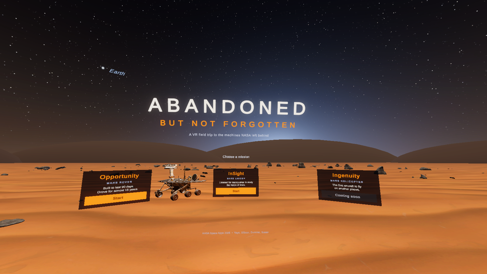
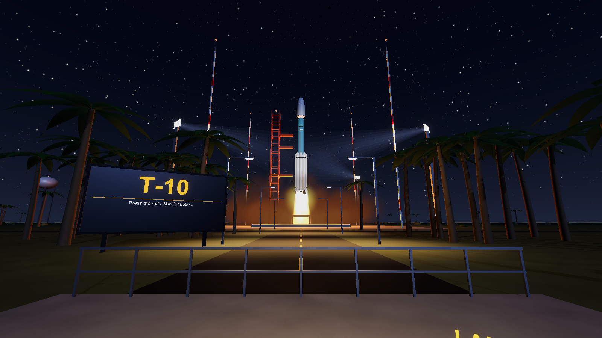
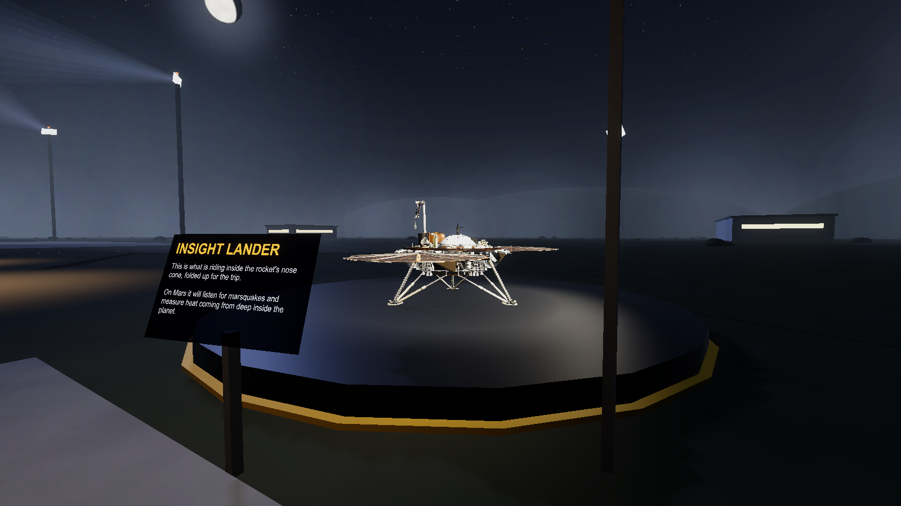
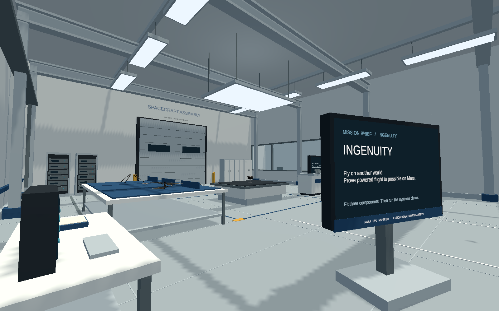

# Still Here: Stories of the Machines NASA Left on Mars

### Abandoned, but not forgotten.

**An interactive Mars mission story built in Unity for Meta Quest 2, with an Editor simulator for reviewers without a headset.**

Still Here invites school-age explorers to meet the machines NASA left on Mars, step into their past, and discover why their work still matters. Build a spacecraft, witness its launch, investigate the science, and return to the hardware that remains. Our goal is to turn distant mission history into a personal connection with robotic exploration.

**NASA Space Apps 2026 · Abandoned but Not Forgotten**  
**Team:** Yarden, Gibson, Dominic, and Susan  
**Audience:** students approximately ages 12–18 and curious space enthusiasts.



## Judges: start here

**For immediate review, open the recorded demonstrations:**

- [Opportunity assembly demonstration — video](launch-previews/Opportunity-Headquarters-Assembly.mp4)
- [Opportunity launch demonstration — video](launch-previews/Opportunity-Launch-Teaser.mp4)
- [Scene screenshots and previews](launch-previews/)

**For hands-on evaluation, use the Unity project below.** A headset is optional for Editor testing. The [experimental browser preview](https://last-signal-browser.vercel.app) is deployed, but a known WebGL startup stall can leave it at 90%. It is not the recommended judging route at submission time.

## Run the project

### 1. Open the correct Unity project

```bash
git clone https://github.com/gnichol479/NASA-Hackathon-2026.git
```

1. Install **Unity Hub** and **Unity Editor 2022.3.62f1**.
2. In Unity Hub, add the nested **`NASA-Hackathon/`** folder inside this repository. It contains `Assets`, `Packages`, and `ProjectSettings`. Do not select the repository root as the Unity project.
3. Let Unity finish importing assets and restoring the packages declared in `Packages/manifest.json`. First import can take several minutes.
4. Use the recorded Unity version rather than upgrading the project.
5. Open **`Assets/Shared/Scenes/TitleScreen-Night.unity`**.

No ElevenLabs account, API key, or live voice-generation request is required to play the included narration.

### 2. Choose a testing mode

| Mode | Setup |
|---|---|
| **Without a headset** | Select **NasaHack → VR → Use desktop XR simulator**, then press Play. Focus the Game view and use the simulator's help overlay to simulate headset/controller movement and interaction. This is an Editor testing route. |
| **Quest 2 through a Windows PC** | Connect the headset through **Meta Horizon Link**, enter Link, and ensure the Meta/OpenXR runtime is active. Select **NasaHack → VR → Use Quest Link (disable simulator)**, then press Play. Use Quest Touch controllers. |

For judging, open the existing scenes directly. Scene-builder menu commands regenerate authored content and are not needed to play.

### 3. Take a short tour

Choose **Opportunity** for the fullest introduction to the narrative format:

1. Meet the rover on Mars and select **See how I got here**.
2. In the assembly facility, take the three components from their benches and release them near their marked attachment positions.
3. Complete **Systems Check**, then select **Ready for Launch**.
4. Watch the launch, continue into landing, and investigate the sample stations.
5. Interpret the evidence and finish with the rover's legacy and final wake-up attempt.

Return to mission selection to try **InSight's interior-science story** or **Ingenuity's assembly and launch**. Stop Play mode and reopen the title scene for a clean restart.

## Controls and demo shortcuts

| Context | Control |
|---|---|
| Quest movement | Left thumbstick moves; right thumbstick turns. Head tracking remains independent. |
| Quest interactions | Grip grabs components; release near a socket to attach. Aim the controller ray and use the trigger for UI. |
| Desktop simulated VR | Use the XR Device Simulator's on-screen control guide. |
| Launch presentation | Any keyboard key starts/skips the countdown; another press after flight starts advances toward the next scene. |
| Scene handoff | **N** skips where a single next destination is configured. |
| Opportunity Landing | **WASD / arrows** drive; **E** investigates; **Enter** begins or advances the mission. |
| Landing conclusion | **1** selects the water-evidence conclusion; **2** selects the alternative and shows retry feedback. |
| Landing photo view | **C** toggles orbit mode; **A/D** orbit, **W/S** zoom, **Q/E** tilt. |
| Opportunity story | **F** triggers the arrival flashback; **U** sends the legacy wake-up command. |

Keyboard skips are presentation aids. Use the scene's interaction buttons to evaluate its educational progression; a skip can bypass an activity. Shortcuts depend on the active scene and Game-view focus.

## The three missions

| Mission | Implemented experience | Learning focus |
|---|---|---|
| **Opportunity — rover** | Present-day arrival, assembly facility, Delta II launch, landing and sample investigation, legacy, and return to the title. | How instruments turn rocks and minerals into evidence of past water, and why a mission matters after communication ends. |
| **InSight — lander** | Assembly, Atlas V launch, descent and landing, surface science, legacy, and return to the title. | How a stationary lander investigates Mars's interior through SEIS, HP³, and RISE. |
| **Ingenuity — helicopter** | Assembly of rotor blades, solar panel, and landing legs; Atlas V launch with the Mars 2020 mission; return to the title. | The engineering behind a helicopter technology demonstration on another planet. Surface flight gameplay is not included in the current scene set. |

```text
Mission selection
├─ Opportunity: Arrival → Assembly → Launch → Landing / Science → Legacy → Title
├─ InSight:     Assembly → Launch → Landing → Surface Science → Legacy → Title
└─ Ingenuity:   Assembly → Launch → Title
```

**Assembly facilities:** components have grab interactions, marked snap targets, feedback, and explanations of their purpose. Completing all three components enables the systems check and launch handoff. The facilities are inspired by spacecraft engineering environments; assembly is an educational simplification.

**Launches:** mission-specific vehicles and settings present Opportunity's Delta II, InSight's Atlas V 401, and the Atlas V 541 that carried Perseverance and Ingenuity. Launch timing and motion are compressed for presentation.

**Opportunity science:** investigate hematite “blueberries,” jarosite, and an inconclusive dust sample. Choose the conclusion supported by the evidence. Scripted readings and instrument animations teach interpretation rather than reproduce laboratory measurements.

**InSight science:** learn what SEIS listens for, what HP³ was designed to measure, and how RISE studies planetary motion. The story acknowledges that HP³ did not reach its intended depth; it does not present the heat probe as a successful deep-drilling experiment.

**Legacy:** bring the story back to the machines on Mars and the knowledge they left behind. Opportunity's wake-up interaction connects the player to the end of communication; InSight's story connects dust accumulation and solar power with the end of its mission.

| Launch | InSight | Ingenuity assembly |
|---|---|---|
|  |  |  |

## Narration, readability, and accessibility

The experience combines readable story panels, captions, nearby instructions, and recorded narration. **ElevenLabs Brian** provides generated voice audio imported as local clips, so playback does not consume API credits. Voice generation is an optional Editor authoring workflow, separate from playing the project.

Opportunity and InSight include recorded mission audio. Ingenuity has a recorded title-card introduction, caption/audio hooks, and an Editor generation tool; full Ingenuity mission voice files are not bundled in this checkout. Audio coverage therefore varies by scene.

The project includes controller-ray UI, an Editor simulator, scene shortcuts for demonstrations, and an orbit view for Opportunity Landing screenshots. It remains a prototype: headset comfort and panel readability can vary with device fit, scene, and viewing distance.

See the [narration guide](NASA-Hackathon/Assets/Shared/Audio/Narration/README.md) for generation and validation tools. Credentials are not required for judges and should never be committed.

## NASA data and scientific accuracy

NASA mission information drives the story, instrument explanations, captions, and narration. We paraphrase factual material and use interactive actions to connect hardware to its scientific purpose.

| Resource | How it contributes |
|---|---|
| [NASA: Opportunity](https://science.nasa.gov/mission/mer-opportunity/) | Mission purpose, instruments, exploration history, and evidence of past water. |
| [NASA: InSight](https://science.nasa.gov/mission/insight/) and [science instruments](https://science.nasa.gov/mission/insight/science-instruments/) | Interior-science objectives, instrument explanations, and mission context. |
| [NASA: Ingenuity](https://science.nasa.gov/mission/mars-2020-perseverance/ingenuity-mars-helicopter/) | Helicopter engineering and the technology demonstration's purpose. |
| [NASA 3D Resources](https://science.nasa.gov/3d-resources/) | Spacecraft models used to connect the interactive experience to real hardware. |
| [HiRISE terrain model ESP_018701_1775](https://www.uahirise.org/dtm/ESP_018701_1775) | Opportunity-area terrain derived from NASA mission data. Credit: NASA/JPL/University of Arizona/USGS. |
| [Opportunity panorama PIA22909](https://www.jpl.nasa.gov/images/pia22909-opportunity-legacy-pan-true-color/) | Mars environment imagery. Credit: NASA/JPL-Caltech/Cornell/ASU. |

The [detailed NASA source register](NASA-Hackathon/Assets/Shared/Audio/Narration/NASA-Sources.md) links the mission, launch, and science references behind the narration. Mission-specific READMEs below provide additional context.

**Interpretive boundaries:** room layouts, assembly order, animated instrument actions, readings, and accelerated flights are designed for learning. Reused Mars scenery supports visual continuity and is not an exact reconstruction of every landing site. First-person storytelling is an authored interpretation, not a record of words spoken by spacecraft. This is a student project, not an official NASA application.

## Technology and project structure

Built with **Unity 2022.3.62f1**, **Universal Render Pipeline 14.0.12**, **XR Interaction Toolkit 2.6.4**, **OpenXR 1.14.3**, **Input System 1.14.0**, **TextMeshPro 3.0.7**, **glTFast 6.18.0**, and **Draco 5.4.3**. ElevenLabs is used for voice authoring; Vercel hosts the experimental WebGL build. GitHub hosts the source and review materials.

```text
NASA-Hackathon/                 ← Open this folder in Unity Hub
├─ Assets/
│  ├─ Shared/                   XR rig, scene flow, narration, launch systems, Mars data
│  ├─ Opportunity/              Arrival, assembly, launch, landing, legacy, models
│  ├─ InSight/                  Assembly, launch, mission scenes, models
│  └─ Ingenuity/                Assembly, launch, models
├─ Packages/manifest.json       Package dependencies
└─ ProjectSettings/             Unity version and enabled build scenes
launch-previews/               Recorded demonstrations and screenshots
```

Shared scene-flow components connect scenes by name. Mission-specific controllers manage assembly and science progression. The saved build list includes 14 scenes, including the older title scene; **TitleScreen-Night** is the intended entry point.

### Detailed implementation guides

- [Opportunity assembly and Quest setup](NASA-Hackathon/Assets/Opportunity/NASA-Headquarters/LastSignalFlashback/README.md)
- [Opportunity landing and science](NASA-Hackathon/Assets/Opportunity/Landing/README.md)
- [InSight assembly and mission](NASA-Hackathon/Assets/InSight/NASA-Headquarters/LastSignalFlashback/README.md)
- [Ingenuity assembly and launch](NASA-Hackathon/Assets/Ingenuity/NASA-Headquarters/LastSignalFlashback/README.md)
- [Narration setup](NASA-Hackathon/Assets/Shared/Audio/Narration/README.md)
- [NASA references](NASA-Hackathon/Assets/Shared/Audio/Narration/NASA-Sources.md)

## Assets, credits, and review notes

**Team contributions:** Yarden developed the arrival and legacy storytelling and Mars environment; Gibson developed the assembly facility and interactions and worked on integration, narration, and VR improvements; Dominic developed launch environments, mission selection, and mission variants; Susan developed Opportunity's landing and science activities. The team integrated and iterated on the shared experience.

**External resources:** NASA and NASA/JPL mission pages, NASA 3D Resources, HiRISE terrain, Opportunity imagery, Unity and its package dependencies, ElevenLabs voice synthesis, GitHub, and Vercel. Source citations and credits accompany the relevant guides. Third-party assets and packages retain their own licenses; their presence does not grant redistribution rights beyond those licenses.

**Optional environment pack:** [Mars Landscape 3D by Evgenii Nikolskii](https://assetstore.unity.com/packages/3d/environments/landscapes/mars-landscape-3d-175814) adds terrain textures and rock dressing. Its Asset Store files are not distributed in Git. To reproduce that dressing, acquire the pack through your Unity account, then use **Window → Package Manager → My Assets → Download → Import**. The environment builder supports generated fallback textures when the pack is unavailable. Do not regenerate scenes solely to start a judging session.

**Troubleshooting:**

- **Wrong Unity version / import errors:** reopen the nested project with 2022.3.62f1 and wait for package import and compilation to finish.
- **Headset view or controls behave incorrectly:** confirm Link is active and select the Quest Link menu option so the desktop simulator is disabled.
- **No headset available:** select the desktop XR simulator menu option and use its help overlay.
- **No narration:** check Game-view mute, device audio output, and clip assignments; Ingenuity's mission narration is incomplete in this checkout. Playing existing clips requires no API key.
- **Web preview remains at 90%:** use the local Unity route or recorded demonstrations. Browser startup is a known unresolved submission-time issue.

Future work includes completing Ingenuity's surface story and narration, resolving browser startup, and further accessibility and comfort testing with students and varied headsets. The long-term goal is a reusable storytelling format for other spacecraft and scientific hardware left across the solar system.